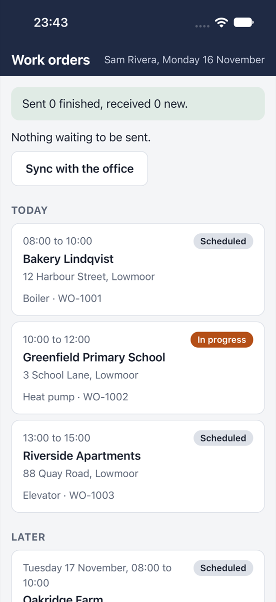
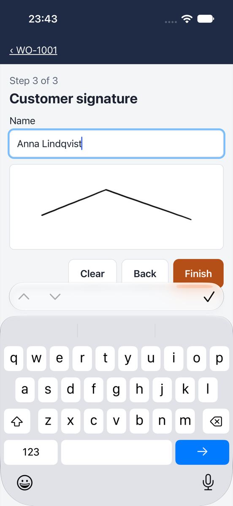
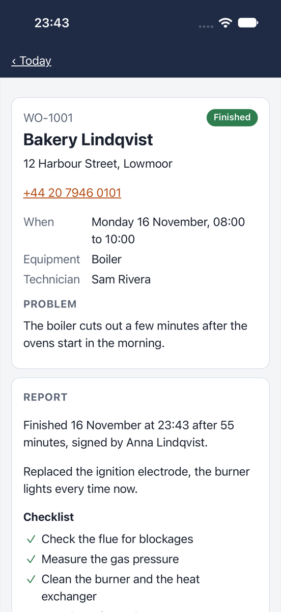

# RIFE2 Work Orders

A field service app written once with [RIFE2](https://rife2.com) and used in
three ways: as the office's web application, as the technician's pages in a
browser, and inside an iPhone app that works without a connection.

A company sends technicians to repair boilers, heat pumps, elevators and solar
inverters. At the office, dispatchers schedule the jobs and read the reports.
On site, the technicians are often in a basement or on a roof without a
signal, so their app has the orders, the checklists, the photos and the
customer's signature on the device, and only needs the office to sync.

  

## Why

RIFE2 embedded is for teams whose product is already a web application, or
has to become one, and who want to ship that same application inside an app.
The forms, the validation and the templates are written once and work the
same in the browser and on the device, also without a network. For an app
that only runs on iPhones and is mostly native controls, SwiftUI is the
better choice.

Here, the site of the technician runs in the app with RIFE2's
[site runner](https://github.com/rife2/rife2/wiki/Site-Runner), which answers
the requests of a web view in the same process, without a server or a port.
GraalVM compiles it to native code
([GraalVM Native Image](https://github.com/rife2/rife2/wiki/GraalVM-Native-Image)),
which makes a framework of about 47 MB that builds in a minute.

## What it shows

| Where | What RIFE2 does there |
|---|---|
| `OfficeSite` | routes with path info, forms generated from constraints, validation groups, CSRF protection, a JSON endpoint with a token |
| `FieldSite` | htmx fragments for the checklist, the parts and the photos, multipart uploads, `PATCH` and `DELETE` routes |
| `SignOff` | a sign-off in three steps written as one method that pauses with `c.pause()`, which is a continuation |
| `Store` | an embedded H2 database through the generic query manager, with migrations |
| `Sync` | the JSON that a device and the office exchange, which stays correct when an answer gets lost or two syncs overlap |
| `ios/` | the technician's site compiled with GraalVM into a native library, answering the web view of a SwiftUI app |

The office and the device run the same code and the same tables. In the site,
the only code that exists just for the app is the sync. What runs the site
inside the app, the bridge between the web view and the site, is
RIFE2's `rife.nativeapp` with [rife2-native-app](../..), the repository
that this example is in: its Swift package and its bld extension, which
builds the native library.

## Running it

You need Java 21 or later. Until RIFE2 1.11.0 is released, the build uses its
`1.11.0-SNAPSHOT`, and the snapshot of rife2-native-app's bld extension,
`bld-native-app`. The iOS app's Xcode project takes the Swift
package of rife2-native-app from this repository.

```console
./bld compile run
```

Open <http://localhost:8080>. That's the office, with a few orders for today.
To see the technician's pages next to it, in another terminal:

```console
./bld compile
java -cp "build/main:lib/compile/*:lib/standalone/*:src/main/resources" workorders.Field
```

Open <http://localhost:8081> and sync: the orders of Sam Rivera arrive from
the office on port 8080. Both keep their database in `data/`.

The settings are system properties or environment variables:

| Property | Variable | Default |
|---|---|---|
| `workorders.port` | `WORKORDERS_PORT` | 8080 for the office, 8081 for the technician |
| `workorders.data` | `WORKORDERS_DATA` | `data/office` or `data/field` |
| `workorders.syncToken` | `WORKORDERS_SYNC_TOKEN` | `demo`, change it for anything real |
| `workorders.technicians` | `WORKORDERS_TECHNICIANS` | `Sam Rivera,Alex Moreau`, who the office can give orders to |
| `workorders.demo` | `WORKORDERS_DEMO` | `true`, the office adds sample orders when nothing is planned from today on |
| `workorders.office` | `WORKORDERS_OFFICE` | `http://localhost:8080`, where the technician's pages sync |
| `workorders.technician` | `WORKORDERS_TECHNICIAN` | `Sam Rivera` |

An office on another machine has to be reached over https, since the token
and the customers' data travel with each sync.

## The tests

```console
./bld compile test
```

They run both sites with `SiteRunner`, the way the app does, through a small
stand-in for a web view (`Browser`) that keeps the cookies, sends the CSRF
token and follows redirects. `WorkdayTest` goes through a whole day: the
dispatcher schedules a job, the technician syncs, works on it offline, signs
it off and syncs again, and the office reads the report. The others also
cover syncs that overlap or lose their answer, photos that aren't images, and
what's refused when an order isn't in the right state.

## The iPhone app

You need Xcode, Python 3, [XcodeGen](https://github.com/yonaskolb/XcodeGen)
(`brew install xcodegen`) and GraalVM Community Edition 25.5
(`sdk install java 25.5.5.0+3-graalce`).

```console
ios/build.sh
```

This builds the technician's site as a native library, puts it in a SwiftUI
app with one web view, and starts it in the iPhone 17 simulator. Without the
address of an office, the app syncs with a demo office that runs inside it,
so it works out of the box. To sync with the office of `./bld run` instead:

```console
OFFICE=http://localhost:8080 ios/build.sh
```

On a device, the address, the token and the technician are in the app's
section of the Settings app.

The build names the site that runs in the app, `AppSite`, and before the
native build `src/main/java/workorders/ios/Embedded.java` goes through three
days of work on the JVM: one with the demo office, one after the app was
started again on the same database, and one with an office that's reached
over HTTP until it goes away. That shows what's wrong in seconds, and lets
the GraalVM tracing agent record what the native library needs. `ios/app/`
is all the Swift that the app has of its own. The approach is the one of
[Gates of Humanity](https://hd.uwyn.com), a RIFE2 app that's on the App Store.

```console
./bld app-check ios-sim
```

This asks the native library for a few addresses inside the simulator, and
checks that it answers exactly as the site does on the JVM.

```console
ios/check-app.sh
```

This uses the installed app with UI tests that tap, type and sign like a
technician. The first syncs, starts a job, ticks its checklist, adds a part,
signs it off in three steps and syncs again. The second adds a photo of the
size that a phone's camera takes, from the photo library, through the page's
file input. It starts from a fresh install, takes a minute and a half, and
with `SHOTS=dir` it also saves the screenshots above.

```console
ios/build-device.sh
```

This builds the app for iPhones and iPads in the Xcode project that XcodeGen
makes of `ios/project.yml`, signed with the team that it names, and checks
that the privacy manifests of the app and of its framework declare what their
code uses.

GraalVM only has the static libraries of the JDK for macOS. Without anything
else, the build uses those with the platform of their object files rewritten,
which is fine to try the app in the simulator. To ship it, build the real ones
from the sources of the JDK with `./bld app-jdk-libs ios`, which takes
about ten minutes once and serves every app on the Mac, or point
`RIFE2_NATIVE_JDK_LIBS` to the ones that were built elsewhere.

## What a real app would add

Each technician would log in, and so would the dispatchers: the office uses a
single token for every device and has no login of its own, which RIFE2's
authentication and its CSRF tokens bound to the user would give it. The
office could cancel an order or give it to another technician, which the
device then hears about at its next sync. Photos would be made smaller on the
device before they're stored and synced. The same site would go inside an
Android app through the same C functions, and a new version of the pages
ships with a new version of the app, so the office has to keep answering the
devices that haven't updated yet.

htmx 2.0.4 is included in `src/main/webapp/js`, under its BSD Zero Clause
License. The rest is licensed under the Apache License 2.0.
